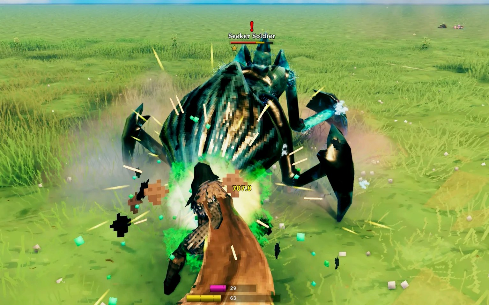

# Valheim Combat Trainer



A BepInEx mod for Valheim that turns a world into a flat, empty training Arena. Copy your real
character into it read-only, spawn any enemy at any stars, and die for free.

What it does and how to use it: [package/README.md](package/README.md) (this is also the Thunderstore page).

## Layout

| Path | What |
|---|---|
| `CombatTrainer.cs` | Plugin, Harmony patches, arena world, F8 menu, fights, character copy |
| `Kits.cs` | Kits (loadouts), kit editor, mead packs, skill presets |
| `package/` | Thunderstore package: manifest, README, icon, preset kits (`kits/*.kit`) |
| `build.sh` | Builds `CombatTrainer.dll` |

## Building

Needs Windows (it uses the C# 5 compiler that ships with .NET Framework 4), Valheim, and
BepInExPack_Valheim (for example an r2modman profile).

```sh
sh build.sh
```

`build.sh` looks for Valheim in the default Steam folder and BepInEx in r2modman's Default profile.
Override either with `VALHEIM_DIR` / `BEPINEX_CORE`, or put them in `build.local.sh` (git ignores it):

```sh
VALHEIM_DIR="D:/SteamLibrary/steamapps/common/Valheim"
```

To install, copy `CombatTrainer.dll` and `package/kits/` into `BepInEx/plugins/CombatTrainer/`. To
release, copy the DLL into `package/` and zip the folder's contents (forward-slash paths).

## Preset kits

Set **Author Mode** in `BepInEx/config/trickstack.CombatTrainer.cfg`: edits to preset kits then save
into the installed mod folder, and your own kits get a **Ship with mod** button. Copy the resulting
`.kit` files into `package/kits/`. The format is plain text:

```
name=MAGE MELEE
item=<prefab>|<quality>|<stack>|<x>|<y>|<equipped 0/1>
```

## License

MIT
