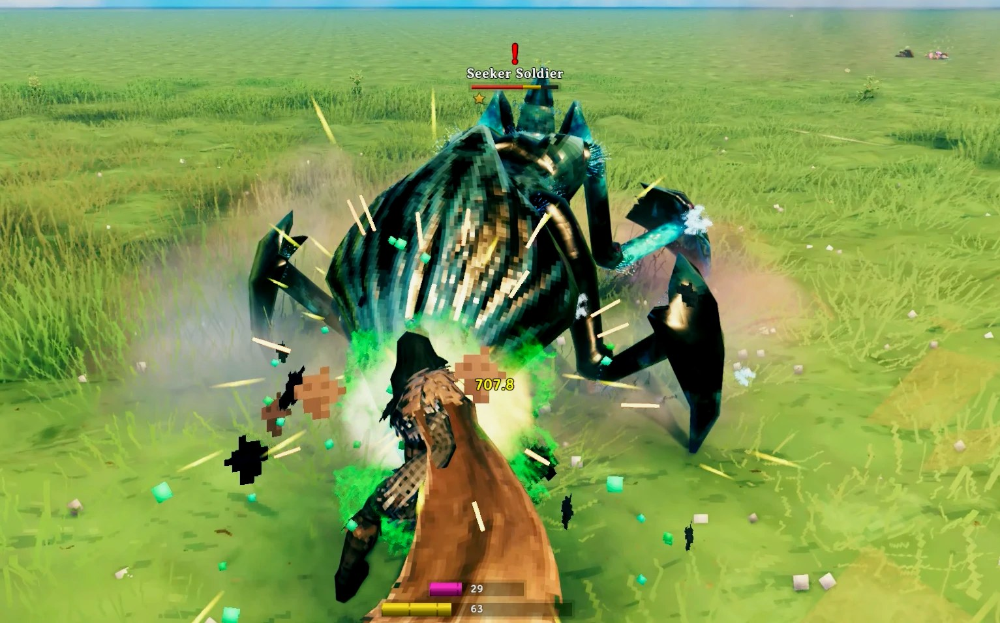

# Combat Trainer

Practice any fight without risking your real character. Make a flat, empty arena world, copy your
character into it read-only, spawn whatever you want to get better at, and die as often as you need.

## Getting started

1. Make a **new character** for training.
2. Make a **new world** and tick **Combat Trainer Arena** on the New World screen.
3. Start the world with the new character and confirm it becomes a trainer.
4. Press **F8**. Copy one of your characters, or pick a kit.
5. Add enemies and press **Fight!**, or start a wave set on the **Waves** tab.

## The arena

A flat Meadows plain with no trees, rocks, dungeons, natural spawns or raids, in clear midday
weather. Every other world plays completely vanilla: the mod does nothing outside an arena world.

## Your real characters stay safe

- **Copy from <character>** (click twice) copies inventory, equipment, skills, foods with their timers,
  known recipes and Forsaken power.
- Trainer characters can only enter arena worlds, so spawned gear never reaches a real world.
- Starting an arena with a character that is not a trainer asks first; say no and nothing happens to it.

## 1v1 (F8, 1v1 tab)

- Search any creature and press **Add**: it appears at once, frozen, in front of you.
  Change stars and count, or remove it.
- **Fight!** starts a 3-second countdown. X, F8 or Esc just close the menu.
- **F8 mid-fight pauses** everything; closing the menu resumes instantly.
- Creatures drop nothing.

## Waves (F8, Waves tab)

- Endless waves from one biome, coming at you from every side, 15-30 m out. Each wave is bigger, tougher
  creatures join as the waves go on, and stars get likelier.
- A built-in set for every biome from Meadows to the Deep North, and three difficulties: **Vanilla**, **Hard**
  and **Very Hard** (more creatures per wave, tougher ones more often and earlier).
- **Edit** any set: add or remove creatures and set how often each shows up, how much the harder
  difficulties favour it, and the first wave it can appear in. Make your own sets too.
- F8 pauses the run. Dying ends it, with a **Retry wave N** button.

## Works with mods

- Creatures and items added by other mods show up in the 1v1, Waves, Items and Kits menus automatically.
  Tested with Monstrum, Warfare and Azu Extended Player Inventory.
- Inventory mods that add equipment or quick slots keep their slots: Combat Trainer never shrinks the inventory.

## Free death and comforts

- No tombstone, no skill loss. Respawn after 2 seconds **where you died**, fed with your last foods,
  at full health, with the same fight set up again.
- Permanent Rested. Full heal about 5 seconds after eating.
- All gear auto-repairs on every kill and every death.
- Food and meads aren't used up in the Arena.
- A stack of Pukeberries to swap foods.

## Items and kits (trainers only)

- **Items:** search any item, give 1 or a full stack, at any quality (past max = Forge of Potential).
- **Kits:** whole-inventory loadouts. **Use** lays out the kit with worn pieces equipped, and you eat
  the kit's foods (up to 3) in place of whatever you had. **Edit** opens
  a mock inventory with both pocket upgrades: click a slot and type to search, drag to move or swap.
  Preset kits ship with the mod (**Reset to Default** undoes your edits); make your own from scratch or
  from your current inventory.
- Mead packs (10 of each) and skill presets: all skills 25 / 50 / 75 / 100, or back to your copied
  character's levels.

Singleplayer.
